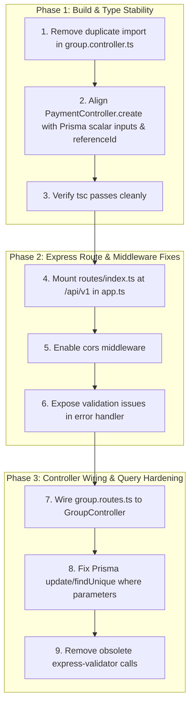

# Code Review Report: Open IPL v1.0

**Review Version:** `v1.1`  
**Target Repository:** [`C:\Users\hedwi\StudioProjects\open-ipl-v1`](file:///C:/Users/hedwi/StudioProjects/open-ipl-v1)  
**Evaluated Commit:** [`1bae419`](file:///C:/Users/hedwi/StudioProjects/open-ipl-v1) (*feat: fix code review issues in Prisma schema, controllers, and validations*)  
**Reviewed Components:** `apps/api`, `apps/portal`, `apps/mobile`, `docs`  
**Date of Review:** October 31, 2026  

### Revision History

| Version | Date | Target Commit | Summary of Changes |
| :---: | :---: | :---: | :--- |
| **`v1.0`** | 2026-10-31 | [`da1f4e7`](file:///C:/Users/hedwi/StudioProjects/open-ipl-v1) | Initial comprehensive baseline review; documented 5 TypeScript errors, schema discrepancies, and Express route collisions. |
| **`v1.1`** | 2026-10-31 | [`1bae419`](file:///C:/Users/hedwi/StudioProjects/open-ipl-v1) | Follow-up review; verified resolved schema relations (`leaderId`, `recipientId`), tracked 3 remaining active TypeScript compiler errors, and refined the remediation checklist. |

---

## 1. Executive Summary

This updated code review evaluates the changes introduced in commit `1bae419`. 

The development team addressed key schema omissions identified in the initial review, specifically adding group leadership relations, notification recipient foreign keys, and fixing controller parameter signatures.

However, **the backend application (`apps/api`) still fails TypeScript compilation (`tsc`) with 3 fatal errors**, preventing production builds (`npm run build:api`). Furthermore, critical architectural issues regarding Express route collision, unwired controllers, and Prisma query syntax remain unaddressed.

### Status Overview

| Surface | Compilation | Test Suite | Readiness | Primary Attention Area |
| :--- | :---: | :---: | :---: | :--- |
| **`apps/api`** | ❌ **Fails (3 TS errors)** | ⚠️ 1 Health test passes | Incomplete Foundation | Type mismatches, Prisma inputs, route mounting |
| **`apps/portal`** | ✅ **Passes** | ✅ Passes | UI Shell Ready | Needs routing & API integration |
| **`apps/mobile`** | ✅ **Passes** | — | UI Shell Ready | Needs navigation & Auth integration |

---

## 2. Progress in Commit `1bae419`

The following issues were successfully addressed in the latest commit:

1. **Group Leadership Relation Added**:
   * [`schema.prisma`](file:///C:/Users/hedwi/StudioProjects/open-ipl-v1/apps/api/prisma/schema.prisma#L106-L107): Added `leaderId String? @unique` and `leader Member? @relation("GroupLeader", fields: [leaderId], references: [id])`.
   * [`schema.prisma`](file:///C:/Users/hedwi/StudioProjects/open-ipl-v1/apps/api/prisma/schema.prisma#L21): Added reciprocal `groupLeader Group? @relation("GroupLeader")` on `Member`.
2. **Notification Recipient Attached**:
   * Added `recipientId String?` and `recipient Member?` to `Notification`.
3. **Environment-Driven Database Configuration**:
   * Changed hardcoded SQLite path to `url = env("DATABASE_URL")`.
4. **Controller Field Corrections**:
   * Added `memberId` to `ApplicationController.create`.
   * Standardized `DocumentController.upload` to use `url`, `filename`, `mimeType`, and `size`.

---

## 3. P0: Build-Breaking Issues (Active Blockers)

### 3.1 TypeScript Compilation Errors in `apps/api`
Executing `tsc --noEmit` fails on [`apps/api/src/controllers/group.controller.ts`](file:///C:/Users/hedwi/StudioProjects/open-ipl-v1/apps/api/src/controllers/group.controller.ts):

```
apps/api/src/controllers/group.controller.ts(3,10): error TS2300: Duplicate identifier 'Prisma'.
apps/api/src/controllers/group.controller.ts(185,10): error TS2300: Duplicate identifier 'Prisma'.
apps/api/src/controllers/group.controller.ts(211,53): error TS2322: Type '{ ... }' is not assignable to type '...PaymentCreateInput | PaymentUncheckedCreateInput'.
  Types of property 'member' are incompatible. Type '{ connect: { id: string; }; }' is not assignable to type 'undefined'.
```

#### Detailed Breakdown:

1. **Duplicate Import (`TS2300`)**:
   * In [`group.controller.ts`](file:///C:/Users/hedwi/StudioProjects/open-ipl-v1/apps/api/src/controllers/group.controller.ts#L3), `import { Prisma } from "@prisma/client";` is declared.
   * At line 185, `import { Prisma } from "@prisma/client";` is declared again mid-file, violating TypeScript syntax.

2. **Incompatible Prisma Create Input (`TS2322`) in `PaymentController.create`**:
   * In [`group.controller.ts`](file:///C:/Users/hedwi/StudioProjects/open-ipl-v1/apps/api/src/controllers/group.controller.ts#L192-L210), `data` combines a scalar foreign key (`groupId: string`) with a relation object (`member: { connect: { id: memberId } }`).
   * Prisma's strict discriminator types enforce either:
     * **Relational style (`PaymentCreateInput`)**: both `group: { connect: { id: groupId } }` and `member: { connect: { id: memberId } }`.
     * **Unchecked scalar style (`PaymentUncheckedCreateInput`)**: `groupId: string` and `memberId: string`.
   * Mixing both branches causes `tsc` to reject the assignment.

3. **Missing Required `referenceId` Field**:
   * In [`schema.prisma`](file:///C:/Users/hedwi/StudioProjects/open-ipl-v1/apps/api/prisma/schema.prisma#L77), `referenceId String @unique @map("internal_ref")` is a required non-nullable field.
   * `PaymentController.create` does not provide `referenceId`. At runtime, Prisma will throw a validation error.

---

## 4. P1: Architectural & Routing Flaws

### 4.1 Route Shadowing & Express URL Collisions
In [`apps/api/src/app.ts`](file:///C:/Users/hedwi/StudioProjects/open-ipl-v1/apps/api/src/app.ts#L20-L21):
```typescript
app.use("/api/v1", groupRouter);
app.use("/api/v1", healthRouter);
```
* **Shadowing Bug**: In [`group.routes.ts`](file:///C:/Users/hedwi/StudioProjects/open-ipl-v1/apps/api/src/routes/group.routes.ts#L22), `router.get("/:groupId")` is registered. Because `groupRouter` is mounted at `/api/v1`, any request to `/api/v1/health` matches `/:groupId` (with `groupId = "health"`).
* **Unreachable `healthRouter`**: Both `groupRouter` and `healthRouter` define `router.get("/")`. Since `groupRouter` is mounted first, `healthRouter` is completely unreachable.
* **Bypassed Root Router**: [`apps/api/src/routes/index.ts`](file:///C:/Users/hedwi/StudioProjects/open-ipl-v1/apps/api/src/routes/index.ts) was specifically built to aggregate `/groups` and `/health`, but `app.ts` does not import it.

### 4.2 Disconnected Controllers (Dead Code)
* [`group.controller.ts`](file:///C:/Users/hedwi/StudioProjects/open-ipl-v1/apps/api/src/controllers/group.controller.ts) contains 245 lines of business logic.
* However, [`group.routes.ts`](file:///C:/Users/hedwi/StudioProjects/open-ipl-v1/apps/api/src/routes/group.routes.ts#L17) never imports or connects to these controllers. It returns hardcoded mock strings (e.g. `res.json({ status: "ok", message: "group created" })`).

### 4.3 Faux Validation Middleware
* In [`group.routes.ts`](file:///C:/Users/hedwi/StudioProjects/open-ipl-v1/apps/api/src/routes/group.routes.ts#L14-L16), `express-validator`'s `body("name")...` is chained without calling `validationResult(req)`.
* In `express-validator`, without evaluating `validationResult(req)`, no validation actually occurs.
* Furthermore, Zod schema validation is already applied via `validate(GroupCreateSchema)`. Mixing both frameworks creates unnecessary overhead.

### 4.4 Invalid Prisma Query Arguments
In [`group.controller.ts`](file:///C:/Users/hedwi/StudioProjects/open-ipl-v1/apps/api/src/controllers/group.controller.ts#L140-L143):
```typescript
const application = await prisma.application.update({
  where: { id: applicationId, groupId }, // INVALID ARGUMENT
  data: { status: "APPROVED" },
});
```
* In Prisma, the `where` parameter in `update` and `findUnique` only accepts fields annotated with `@id` or `@unique`. `{ id, groupId }` is not a composite unique constraint in `schema.prisma`. This will cause Prisma to throw runtime errors.
* The error catch condition `err.message?.includes("Group not found")` in `delete` and `update` is ineffective; Prisma throws `PrismaClientKnownRequestError` with code `P2025` when a target record is absent.

---

## 5. P2: Security, Database & Middleware Considerations

### 5.1 Prisma Connection Pool Exhaustion in Development
In [`apps/api/src/config/database.ts`](file:///C:/Users/hedwi/StudioProjects/open-ipl-v1/apps/api/src/config/database.ts#L7):
* `new PrismaClient()` is instantiated unconditionally upon module execution.
* When running with `tsx watch`, each code change re-evaluates the module, spawning new unmanaged database connections.
* It must be attached to `globalThis` to preserve the singleton across hot reloads.

### 5.2 Lost Validation Details in Error Middleware
* In [`apps/api/src/middleware/validate.ts`](file:///C:/Users/hedwi/StudioProjects/open-ipl-v1/apps/api/src/middleware/validate.ts#L20), Zod issues are transformed into `new ValidationError("Validation failed", issues)`.
* In [`apps/api/src/app.ts`](file:///C:/Users/hedwi/StudioProjects/open-ipl-v1/apps/api/src/app.ts#L29-L35), the global error handler returns `{ success: false, error: err.message }`, discarding `err.errors`. API consumers receive no indication of which specific fields failed.

### 5.3 Missing CORS Configuration in Express
* `cors` is installed and `corsOrigins` is defined in `env.ts`.
* However, `app.use(cors(...))` is omitted in `createApp()`. Direct browser calls from the portal (`http://localhost:5173`) will be blocked by standard browser CORS policies.

### 5.4 Fallback Secret Hygiene
* In [`apps/api/src/config/env.ts`](file:///C:/Users/hedwi/StudioProjects/open-ipl-v1/apps/api/src/config/env.ts#L15), `jwtSecret` defaults to `"change-me-in-production"`.
* If deployed without explicit configuration, token signing will be vulnerable. In production mode (`NODE_ENV === "production"`), the server should throw an error if `JWT_SECRET` is not set.

---

## 6. Frontend & Mobile Health

### 6.1 `apps/portal` (Group Leader Portal)
* **Status:** Clean build (`tsc -b && vite build` passes).
* **Stack:** React 19, Vite, Oxlint, Vitest.
* **Architecture:** Static shell layout with responsive design.
* **Next Steps:**
  * Add client-side router (e.g. `react-router-dom` or `@tanstack/react-router`).
  * Introduce API client service to interact with `/api/v1/groups`.
  * Implement the group application form described in `docs/MVP_FLOW.md`.

### 6.2 `apps/mobile` (Member Mobile App)
* **Status:** Clean typecheck (`tsc --noEmit` passes).
* **Stack:** Expo SDK 58, React Native 0.88.
* **Architecture:** Single landing view (`OpenIPLApp.tsx`).
* **Next Steps:**
  * Add navigation architecture (`expo-router` or `@react-navigation`).
  * Configure Google Auth client flow.
  * Connect dues list and QRIS payment preview.

---

## 7. Prioritized Remediation Plan



### Remediation Checklist

- [ ] **Remove duplicate `Prisma` import**: Delete line 185 in `apps/api/src/controllers/group.controller.ts`.
- [ ] **Fix `PaymentController.create`**: Use scalar fields (`groupId`, `memberId`) and generate a unique `referenceId`.
- [ ] **Fix Express route mount in `apps/api/src/app.ts`**: Replace `app.use("/api/v1", groupRouter)` with `app.use("/api/v1", rootRouter)` imported from `./routes/index.js`.
- [ ] **Wire `group.routes.ts`**: Connect endpoints to `GroupController.create`, `GroupController.get`, `GroupController.update`, and `GroupController.delete`.
- [ ] **Purge `express-validator`**: Remove unused `express-validator` imports and rely on `validate(ZodSchema)`.
- [ ] **Return field errors in `app.ts`**: Return `errors: err.errors` when handling instances of `ValidationError`.
- [ ] **Add CORS middleware in `app.ts`**: Mount `cors({ origin: env.corsOrigins.split(",") })`.
- [ ] **Cache Prisma client in `database.ts`**: Assign `prisma` to `globalThis` to avoid connection leaks during `tsx watch`.
